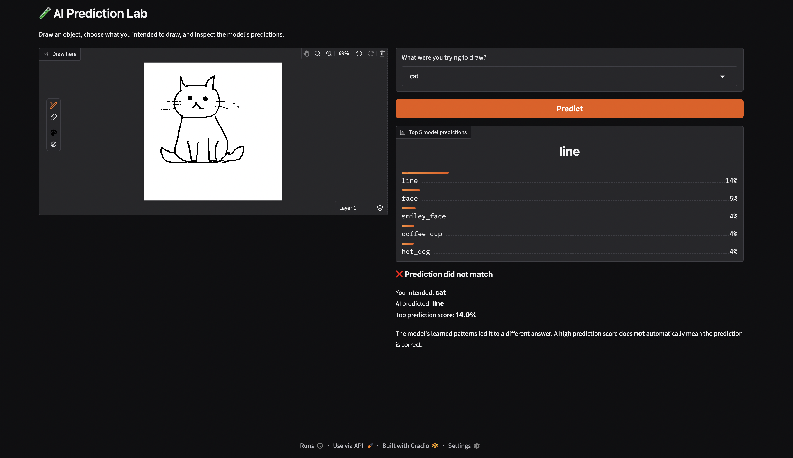
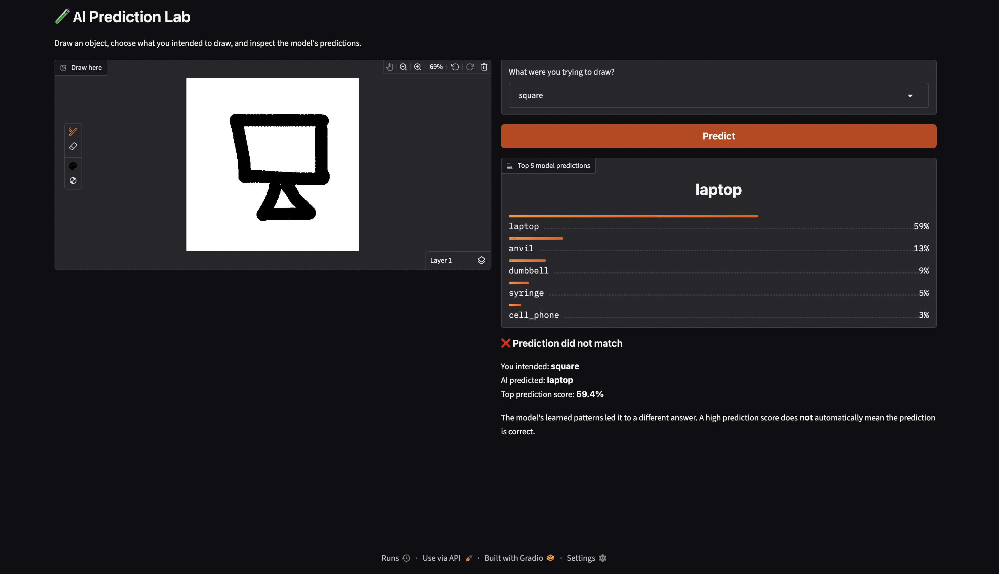
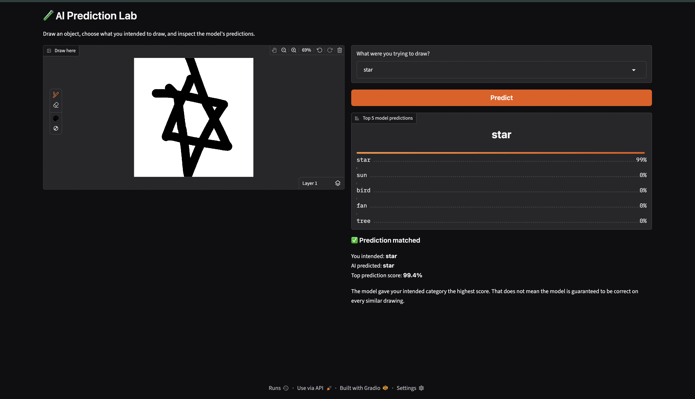
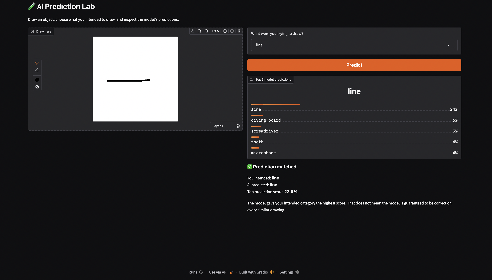
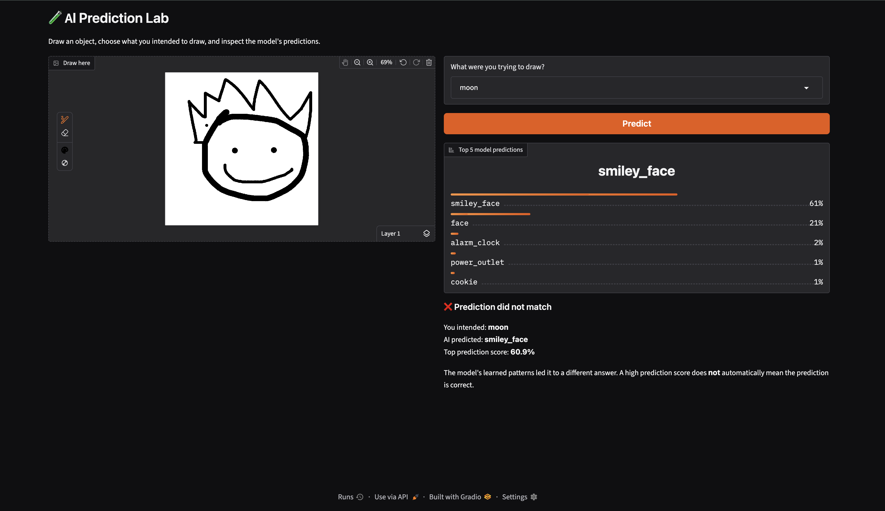
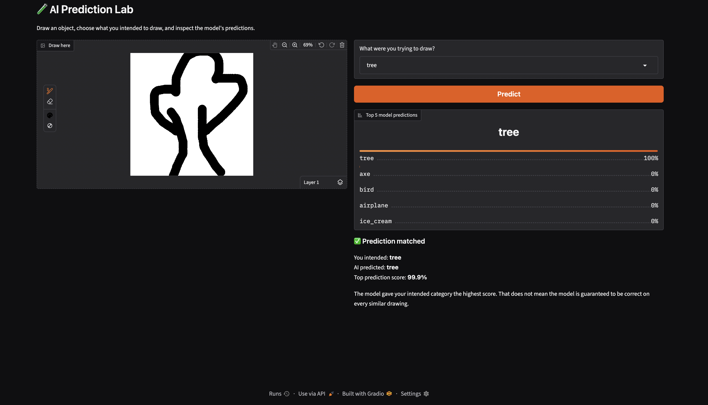

# 🧪 AI Prediction Lab

A browser-based AI application that classifies hand-drawn objects using a pre-trained QuickDraw model.

## 🚀 Overview

AI Prediction Lab allows users to draw objects and observe how an AI model classifies them. It displays the top five predictions, their scores, and whether the highest-scoring prediction matches the intended object.

## ✨ Features

- Interactive drawing canvas
- Pre-trained AI model for object classification
- Top five predictions with scores
- Comparison between intended and predicted categories
- Experiments with correct and incorrect predictions
- Simple browser-based interface

## 🛠️ Technologies Used

- Python
- PyTorch
- Gradio
- NumPy
- Pillow
- Hugging Face Hub

## ⚙️ Installation and Setup

### 1. Clone the repository

```bash
git clone https://github.com/harshavemula18/ai-prediction-lab.git
cd ai-prediction-lab
```

### 2. Create a virtual environment

```bash
python3 -m venv .venv
source .venv/bin/activate
```

### 3. Install dependencies

```bash
python -m pip install -r requirements.txt
```

### 4. Run the application

```bash
python app.py
```

Open the local URL displayed in the terminal, usually http://127.0.0.1:7860.

The first run requires an internet connection to download the model files.

## 🧪 Experiments

The experiments explore:

1. Recognising a clear drawing
2. Changing the same drawing
3. Removing or changing visual features
4. Testing ambiguous drawings
5. Observing incorrect predictions
6. Testing different object categories

   ## 🧪 AI Prediction Lab — Experiment Results


## 🧪 AI Prediction Lab — Experiment Screenshots

### 1. Cat Test


### 2. Laptop Test


### 3. Star Test


### 4. Line Test


### 5. Smiley Face Test


### 6. Tree Test


## 💡 Key Learning

AI models learn patterns from training examples and use them to make predictions. A prediction score does not guarantee that the predicted category is correct.

## 👨‍💻 Author

**Sri Harsha Vemula**

GitHub: [harshavemula18](https://github.com/harshavemula18)

